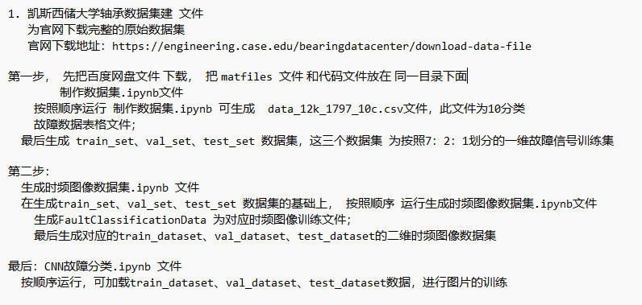
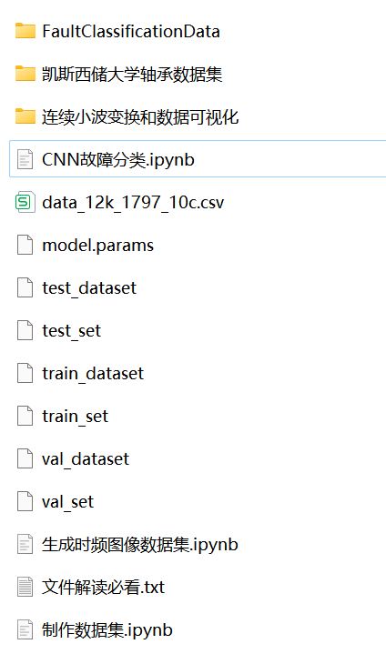
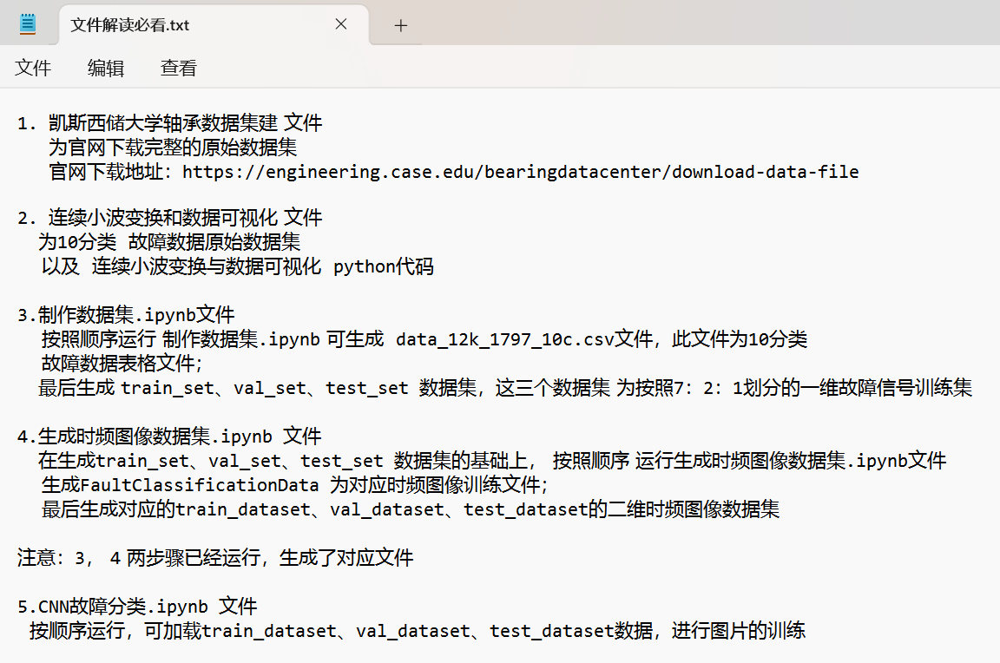

# Python-Case Western Reserve University (CWRU) Bearing Data Interpretation and Classification Processing

Please remember to install Jupyter with pip for running code.
Then run the code in order according to file sequence, otherwise directly run the classification code and it will throw an error!
1. Generate the dataset.ipynb
2. Generate Time-Frequency Image Dataset.ipynb
3.CNN fault classification.ipynb
The PyCharm code file has been uploaded, and everyone can update and download it! This includes the complete CWRU bearing fault dataset, as well as the one-dimensional fault signal dataset and time-frequency image dataset that have been generated and ready for use. The corresponding codes are all operational.
Environment: Python 3.9
\n        \n  
\n        \n  
\n        \n  

## Images

<!-- PAYMENT_BLOCK -->

## Get this dataset

- Payment link (Stripe): [Buy now](https://buy.stripe.com/3cs8yP7sY87d0vu9AB)
- Payment QR code: 

<!-- /PAYMENT_BLOCK -->
